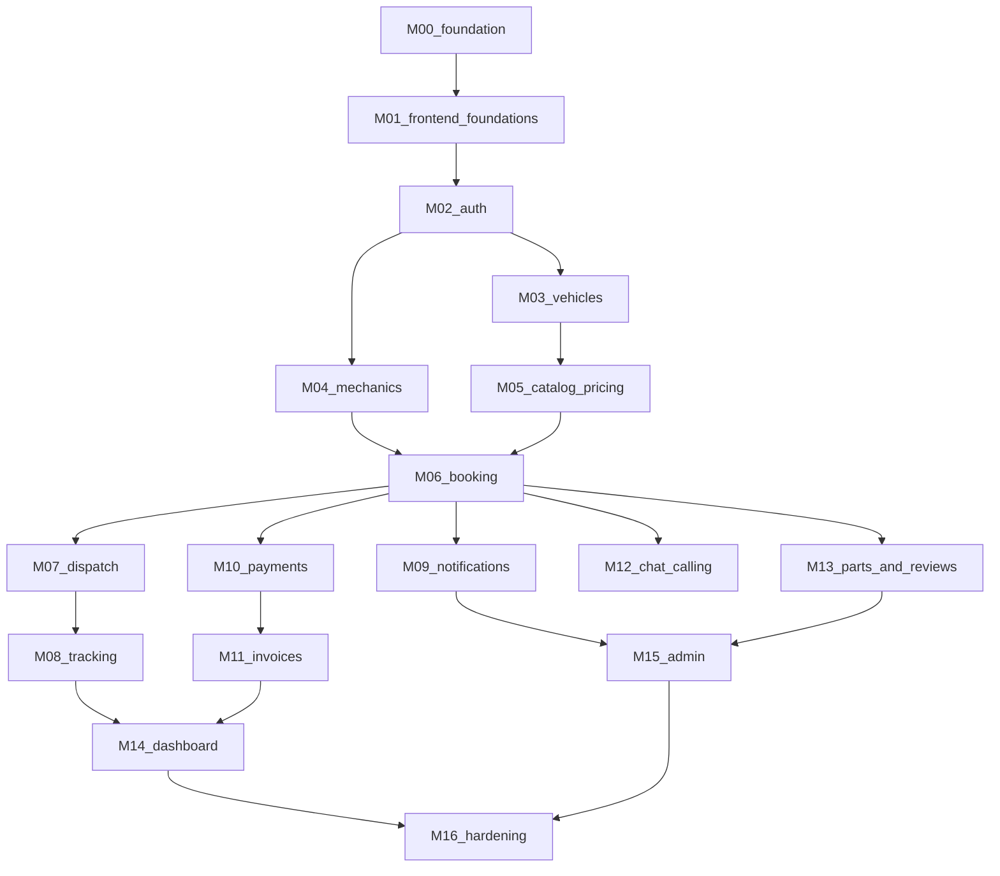

# Milestones

Build one milestone per session, in order. Dependencies:

There is no cycle. M03 and M04 can be done in either order after M02. M09 can run after M06 without waiting for M07. The recommended order is the numeric order.

## Index

| ID | File | One-line goal |
| --- | --- | --- |
| M00 | [M00-foundation.md](milestones/M00-foundation.md) | Layout, CI, emulator, composition roots, fakes for Clock, Logger, FeatureFlags |
| M01 | [M01-frontend-foundations.md](milestones/M01-frontend-foundations.md) | Analyzer clean, dead code gone, demo looks the same |
| M02 | [M02-auth.md](milestones/M02-auth.md) | Phone OTP port, token check, roles, profile bootstrap |
| M03 | [M03-vehicles.md](milestones/M03-vehicles.md) | Vehicles through Flutter, FastAPI, Firestore, and Drift |
| M04 | [M04-mechanics.md](milestones/M04-mechanics.md) | Mechanic onboarding and verification |
| M05 | [M05-catalog-pricing.md](milestones/M05-catalog-pricing.md) | Catalog and estimate engine |
| M06 | [M06-booking.md](milestones/M06-booking.md) | Booking state machine and idempotent create |
| M07 | [M07-dispatch.md](milestones/M07-dispatch.md) | Matching, timeouts, reassignment |
| M08 | [M08-tracking.md](milestones/M08-tracking.md) | Map, ETA, stale location |
| M09 | [M09-notifications.md](milestones/M09-notifications.md) | Push, in-app, matrix |
| M10 | [M10-payments.md](milestones/M10-payments.md) | Cashfree, cash, wallet, coupons |
| M11 | [M11-invoices.md](milestones/M11-invoices.md) | GST PDF |
| M12 | [M12-chat-calling.md](milestones/M12-chat-calling.md) | Chat and masked-call port |
| M13 | [M13-parts-and-reviews.md](milestones/M13-parts-and-reviews.md) | Parts photos and reviews |
| M14 | [M14-dashboard.md](milestones/M14-dashboard.md) | Home, history, repeat, emergency contacts, share link |
| M15 | [M15-admin.md](milestones/M15-admin.md) | Admin web, RBAC, disputes, analytics |
| M16 | [M16-hardening.md](milestones/M16-hardening.md) | Security, cost, accessibility, Hindi, release checklist |

## Requirement coverage

| IDs | Milestone |
| --- | --- |
| NFR-MAIN-002, NFR-SEC-003, layout and CI | M00 |
| Audit deletes, analyzer, shared widgets, ARB scaffold | M01 |
| FR-AUTH-001–005 | M02 |
| FR-VEH-001–004, FR-VEH-006 | M03 |
| FR-VEH-005 | M14 |
| FR-MEC-001–004, FR-MEC-003 | M04 |
| FR-MEC-005 | M07 |
| FR-MEC-006 | M06 API, mechanic controls finished in M07 |
| FR-MEC-007 | M10 |
| FR-MEC-008 | M13 |
| FR-BOOK-003, FR-PAY-001 | M05 |
| FR-BOOK-001, 002, 004, 005, 006, 007, 009 | M06. SOS timings and the extra-work timer are M07 |
| FR-BOOK-008 | M07 |
| FR-TRK-001–007, FR-TRK-005 link storage | M08 creates location. M14 adds the share UI if not finished in M08. Spec: M08 creates the token endpoint and a share button. M14 adds emergency contacts as recipients |
| FR-NOT-001–004 | M09 |
| FR-PAY-002–010, FR-USR-004, FR-USR-005 | M10 |
| FR-INV-001–002 | M11 |
| FR-COM-001–004 | M12 |
| FR-REV-001–004 | M13 |
| FR-USR-001–003, 006, 007, 009 | M14 |
| FR-USR-008 | No milestone. Display-only if a fixture has points. Do not build an API |
| FR-ADM-001–009 | M15 |
| NFR-A11Y, NFR-I18N Hindi, release | M16 |

## Audit item coverage

| Item | Milestone |
| --- | --- |
| Keep Riverpod and go_router | M01 records it. No migration |
| `lib/core/theme`, shared widgets | M01 |
| Delete `lib/screens`, `lib/theme`, unused packages, missing asset dirs | M01 |
| Duplicate permission screens | M01 keeps one. M02 calls real permission APIs |
| Auth screens | M02 |
| Bikes | M03 |
| Booking wizard | M05 and M06 |
| Tracking behavior | M08 |
| Emergency behavior | M06 and M07 |
| Inspection UI | M13 |
| Invoice screen | M11 |
| Wallet and offers | M10 |
| Profile, history, home, health | M14 |
| Support FAQ | Stays mock. Dispute queue is M15 |
| Fuel, membership, referral, documents | No backend. Every milestone must leave their routes working |
| Broken widget test | M01 |

## Ports by milestone

| Port | First milestone |
| --- | --- |
| Clock, Logger, FeatureFlags | M00 |
| AuthService, AuthVerifier, UserRepository | M02 |
| VehicleRepository, FileStorage is not required for vehicles | M03 |
| MechanicRepository, FileStorage, AuditLog | M04 |
| CatalogRepository, PricingService | M05 |
| BookingRepository | M06 |
| DispatchService, JobScheduler | M07 |
| LocationTrackingService, MapsService | M08 |
| NotificationSender | M09 |
| PaymentGateway, PaymentRepository, WalletService, CouponService | M10 |
| InvoiceService | M11 |
| ChatService, TelephonyPort | M12 |
| ReviewRepository | M13 |
| AnalyticsService | M15 |
| DisputeRepository | M15 |

Phase 2 ports in chapter 08 stay uncoded.

## Session rule

Read `AGENTS.md`, `docs/PRD.md`, `docs/AGENT_PROGRESS.md`, and the one milestone file. Finish that file's definition of done, including its PR, before opening the next milestone's branch.
