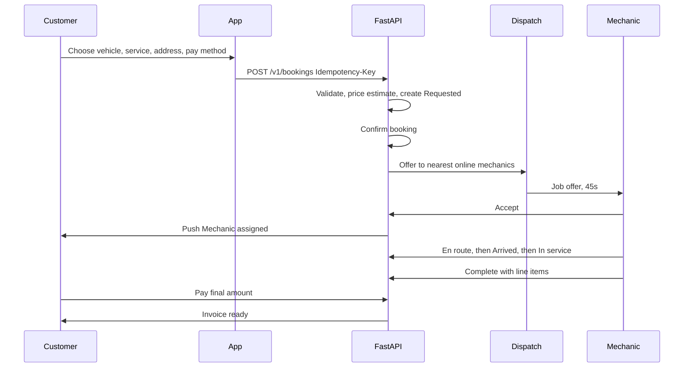

# 02 — Personas and journeys

Names below are example people, not real users.

## Personas

### Riya — customer, two-wheeler

- Lives in Patna, rides a commuter bike to work.
- Books from her phone, often on a spotty connection.
- Wants a price before she confirms, and a photo if a part is replaced.
- Speaks Hindi and English. MVP copy is English. She is why Hindi is scheduled, not skipped forever.
- Pain: last time a roadside mechanic quoted one price and charged another.

### Arjun — customer, four-wheeler

- Books for a family car, sometimes for a parent who is not the account holder.
- Wants to share a tracking link with his father and to save a home and office address.
- Pays by UPI. Occasionally pays cash when the network fails at the end of the job.
- Pain: he cannot tell whether the mechanic has actually reached the car.

### Imran — mechanic

- Six years of experience, covers a few neighbourhoods, works from an Android phone.
- Needs a clear accept/reject choice, navigation, and an earnings total he can trust.
- Uploads parts photos from the roadside, sometimes while offline for a minute.
- Pain: jobs that cancel after he has already ridden across town, with no fee.

### Neha — support

- Handles complaints from a web admin, not from the customer app.
- Can read a booking, issue a refund request, and add an internal note.
- Cannot change prices or mark a mechanic verified. That is an admin action and it is audited.
- Pain: no single timeline of status, payment, and chat.

### Kabir — admin

- Verifies mechanic documents, creates coupons, and reads the revenue dashboard.
- A super-admin can grant the admin role. Kabir cannot.
- Pain: verification today would be a spreadsheet. The product needs a queue.

## Roles

| Role | App | Can do |
| --- | --- | --- |
| `customer` | Customer | Own profile, vehicles, bookings, payments, reviews |
| `mechanic` | Mechanic | Own profile, availability, assigned jobs, parts photos, earnings read |
| `support` | Admin web | Read orders, manage disputes, notes. No price or verification writes |
| `admin` | Admin web | Verification decisions, coupons, user suspend, refunds |
| `super_admin` | Admin web | Everything an admin can do, plus role grants |

A person has one role in MVP. A mechanic who also owns a vehicle uses two accounts. Combining them is Phase 2.

## Journey: instant booking (happy path)

Step by step:

1. Riya opens the app. If she is offline she can browse cached vehicles and the service catalog, and she can fill a draft. She cannot submit.
2. She picks her bike, "General Service", her home address, and UPI.
3. She sees an itemized estimate: labor, parts (if any are known), GST, convenience fee, coupon. She confirms once. A second tap does not create a second booking.
4. The job is confirmed and offered to mechanics in range.
5. Imran accepts. Riya sees his name, photo, rating, languages, and the verified badge.
6. She watches the map. When he is within 150 metres and marks arrived, she gets "Mechanic arrived".
7. He starts work. If he needs a part that was not on the estimate, Riya must approve the new line before he fits it.
8. He uploads before, after, and old-part photos. She sees them on the booking.
9. She pays the final amount. The invoice PDF is stored and downloadable.
10. She rates the job. The aggregate on Imran's profile updates on the server, not on her phone.

## Journey: breakdown (SOS)

1. Arjun taps Emergency and chooses "won't start" or "breakdown".
2. The booking is `urgency=sos`. Dispatch uses a 20 second offer timeout and a wider search after the first miss. Ranking prefers mechanics who are online and closer, ahead of rating.
3. The map and chat are the same as a normal job. Copy says "Priority request" so the customer knows it is not a scheduled service.
4. If nobody accepts after two reassignments (three offers), the booking becomes `failed` and the customer sees "No mechanic is free nearby. Try again or call support." Support phone comes from config, not from a hardcoded string in the widget.

## Journey: mechanic day

1. Imran signs in with phone OTP. Until an admin sets `verified=true`, the app shows "Verification in review" and the availability switch is disabled.
2. He turns availability on. He appears in dispatch only while the switch is on and the app has sent a heartbeat in the last 2 minutes.
3. An offer shows distance, estimate, vehicle type, and a 45 second countdown. Reject or timeout returns the job to the pool. Accept moves it to him and to no one else.
4. He navigates with Google Maps (external turn-by-turn is allowed; in-app polyline is required).
5. He moves status forward only along the legal transitions in [state machines](13-state-machines.md).
6. Earnings for the day are the sum of paid jobs' mechanic share. The share percentage is config (default 80% of labor, 0% of GST). Parts are pass-through at cost in MVP, not marked up by the platform.

## Journey: verification

1. Imran submits name, photo, languages, service area, experience years, and documents: driving licence, Aadhaar (masked in the UI after upload), and a work photo or certificate.
2. Files go to Cloud Storage through FastAPI (the app asks for an upload URL). The client does not write the `verified` field.
3. Kabir sees the queue, opens each file, and approves or rejects with a reason.
4. Approval sets the custom claim and the profile flag. Rejection lets Imran resubmit. Both actions write an audit log row.

## Journey: dispute

1. After `arrived`, Riya cannot cancel. She can open a dispute with a reason and optional photos.
2. Neha sees the timeline: status changes, payment, chat, parts photos.
3. Neha can request a refund. The refund is executed by FastAPI through Cashfree, or recorded as a cash adjustment. Neha does not type a new price into Firestore.
4. Resolution moves the booking to `paid` (if the customer still owes nothing) or leaves a refund record. The dispute itself ends as `resolved` or `rejected`.

## Journey: admin coupon

1. Kabir creates `FLAT50`, 50 rupees off, minimum bill 299, valid for 30 days, 100 redemptions, first-booking only.
2. Customers see it in Offers. Applying it re-checks the rules on the server at estimate time and again at payment time. A coupon that expired between those two moments is removed and the customer is told why.

## Empty, offline, and failure moments

| Moment | What the user sees |
| --- | --- |
| No saved vehicles | "Add a vehicle to book a service" and a button. Booking stays disabled. |
| No mechanics in range | "No mechanic is free nearby right now." Retry and support. Booking becomes `failed`. |
| Mechanic cancels after accept | "We're finding another mechanic." One automatic reassignment. Then the failed state. |
| Payment pending | "Waiting for payment confirmation." Poll and webhook. Do not show success early. |
| Offline on the home screen | Banner "You're offline. Saved vehicles and past bookings are available." Submit buttons disabled. |
| GPS off during tracking | "Location is off. Turn it on to share your position." The other party's last point stays on the map with the age. |
