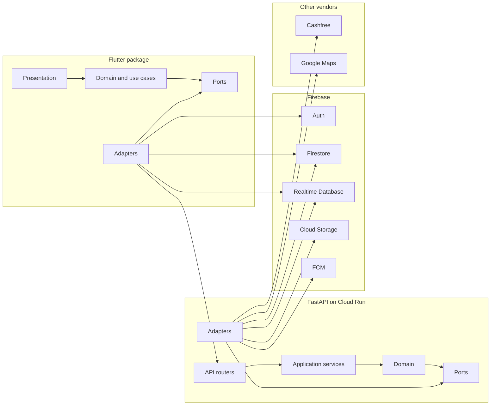
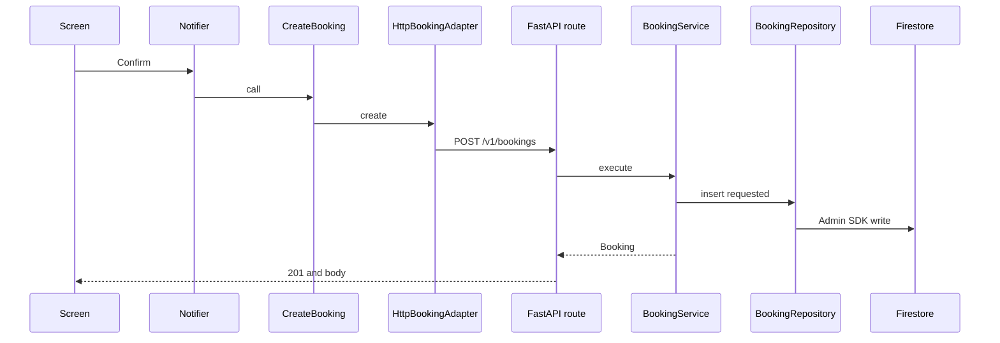

# 07 — System architecture

## Shape

MechaniCA is a modular monolith on the server and a feature-first app on the client. "Hexagonal" here means a practical rule: domain code does not import Firebase, Cashfree, Google Maps, or any other vendor SDK. Those sit in adapters. The domain talks to ports (interfaces). One composition root binds an interface to an adapter per process.



The arrows into Firebase from the Flutter adapters are reads, location writes, and auth. They are not a second way to change a booking.

## Why this shape

| Layer | Reason it exists |
| --- | --- |
| Domain | Booking rules must be testable without a phone or a cloud project. |
| Ports | Auth, payments, maps, and the database are the things the team may swap. |
| Adapters | Vendor SDKs change. The rest of the app should not. |
| Composition root | One file should answer "which implementation is live?" |
| Fake adapters | The demo and CI must run with no keys. |

We do not add a port for `List`, `DateTime`, or Flutter widgets. We do not add a generic repository base class until three repositories have grown the same non-trivial behavior. Drift, Firebase, and HTTP are allowed to look different.

## Flutter target layout

M00 moves `mechanica_app/` to `app/` with `git mv`. Until then, paths below are the target. The demo's `lib/features`, `lib/providers`, and `lib/mock` stay where they are until the milestone that owns them.

```
app/
  lib/
    main_customer.dart          # entry
    main_mechanic.dart
    main_admin.dart
    bootstrap.dart              # binding, orientation, ProviderScope
    composition/
      providers.dart            # composition root
    core/
      config/                   # flavors, dart-define
      error/                    # Result, failures
      theme/
      router/
      l10n/
      network/
    shared/widgets/
    features/<feature>/
      presentation/             # screens, view models
      domain/                   # entities, port interfaces, use cases
      data/
        adapters/               # firebase, cashfree, maps, http
        mappers/
        local/                  # Drift
  test/
  integration_test/
```

Rules:

- Widgets call use cases or notifiers. They do not import `cloud_firestore`, `firebase_database`, `cashfree_pg`, or `google_maps_flutter`.
- Those imports are legal only under `features/*/data/adapters/` and `core/` networking that is itself an adapter.
- A feature may import its own domain and `core`. It may not import another feature's `data`. Cross-feature use goes through a port in `core` or through routing with an id.
- M00 adds a CI check (a Dart script or `import_lint` style rule) that fails if a banned import appears outside adapters.

State: Riverpod providers in `composition/providers.dart` construct adapters from `AppConfig`. Feature notifiers take ports in their constructors. `ref.watch` is how the UI subscribes. That is the composition root. We do not also add get_it.

Flavors: `--dart-define-from-file=config/dev.json` with `APP_ENV`, `API_BASE_URL`, `USE_FIREBASE_EMULATOR`, and `PROVIDER_PAYMENTS=fake|cashfree`. The same keys exist for maps, auth, and push. Business code reads `AppConfig`, never `String.fromEnvironment` in a widget.

## FastAPI target layout

M00 moves `mechanica_api/` to `backend/`.

```
backend/
  pyproject.toml
  Dockerfile
  app/
    main.py                     # FastAPI app, router include, middleware
    core/
      config.py                 # pydantic-settings
      errors.py
      logging.py
    api/
      deps.py                   # composition root: Depends providers
      v1/
        routes_*.py
    application/                # use cases, one module per feature
    domain/
      models.py
      booking_state.py
    ports/                      # Protocol classes
    adapters/
      fake/
      firebase/
      cashfree/
      google_maps/
      tasks/
  tests/
```

`deps.py` reads settings and returns the fake or the real adapter. Routers depend on use cases. Use cases depend on ports. Domain imports neither FastAPI nor firebase_admin.

## Composition roots

| Process | Root | Selects |
| --- | --- | --- |
| Flutter | `app/lib/composition/providers.dart` | Adapters from `AppConfig` |
| FastAPI | `backend/app/api/deps.py` | Adapters from `Settings` |
| Tests | The test builds the use case with fakes directly | No global mutable container |

There is no service locator that any widget can reach into.

## Provider swap matrix

| Concern | Current choice | Port | Adapter folder | To swap |
| --- | --- | --- | --- | --- |
| Sign-in | Firebase Auth phone OTP | `AuthService` | `adapters/firebase` | New adapter, change `PROVIDER_AUTH` |
| Token check | Firebase Admin verify | `AuthVerifier` | `backend` firebase adapter | New verifier, same binding |
| Users, vehicles, bookings, mechanics, reviews | Firestore | `*Repository` | firebase adapter | New repository adapter. Domain entities stay. |
| Live location | Realtime Database | `LocationTrackingService` | firebase adapter | New adapter if we leave RTDB |
| Chat stream | Firestore subcollection, read by client | `ChatService` | firebase adapter | New adapter |
| Files | Cloud Storage | `FileStorage` | firebase adapter | S3-compatible adapter |
| Maps, ETA, geocode | Google Maps | `MapsService` | google adapter | New adapter, new key |
| Online payments | Cashfree | `PaymentGateway` | cashfree adapter | New gateway adapter |
| Payment records | Firestore via API | `PaymentRepository` | firebase adapter | Moves with the database |
| Push | FCM | `NotificationSender` | firebase adapter | New sender |
| SMS | None until enabled | `NotificationSender` channel | sms adapter | Provider key |
| PDF | Server-side library (WeasyPrint or reportlab, chosen in M11) | `InvoiceService` | backend adapter | Replace renderer |
| Timers | Cloud Tasks and Scheduler | `JobScheduler` | tasks adapter | Another HTTP scheduler |
| Flags | Env plus a small Firestore doc read by API | `FeatureFlags` | config adapter | Remote Config later |
| Analytics | Log adapter first | `AnalyticsService` | log adapter | Vendor SDK in the adapter only |
| Time | System clock | `Clock` | core | Fake clock in tests |
| Logs | Structured stdout | `Logger` | core | Cloud Logging reads stdout on Cloud Run |

Wallet and coupons are domain services (`WalletService`, `CouponService`) implemented in application code, using repositories. They are not vendor SDKs. They still sit behind interfaces so tests can fake a ledger.

## Request path (booking create)



The screen does not know Firestore exists. Firestore security rules still deny the client a direct status write, so a buggy screen cannot bypass this path.

## What we are not building

- Microservices. One Cloud Run service.
- A message bus for commands. HTTP and Cloud Tasks are enough at the design load.
- CQRS frameworks. The read model is the Firestore document the API wrote, plus a few denormalized fields documented in chapter 09.
- A custom DI framework.

## Migration from the demo

The demo's `Mock*Repository` classes become the fake adapters. Screens keep calling notifiers. Notifiers start calling use cases instead of the mock repository directly, one feature per milestone. Until a feature's milestone, its notifier may still use the old mock so the demo stays up. M01 does not boil that ocean.
