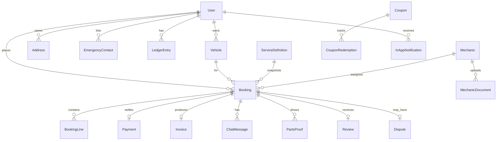

# 09 — Domain and data model

JSON examples in the [glossary chapter](25-glossary-and-appendices.md) match these fields. Money is paise (integers). Timestamps are ISO-8601 UTC. Ids are UUID strings generated by the server, except Firebase Auth uid which is the user id.

The demo's `BookingStatus` (`pickedUp`, `inWorkshop`, `outForDelivery`) is not this model. Do not migrate those names forward.

## Entities



### User

`id` (auth uid), `role`, `name`, `phoneE164`, `email?`, `photoPath?`, `status` (`active` or `suspended`), `createdAt`, `updatedAt`.

Not on the user: wallet balance, rating, coupon state.

### Vehicle

`id`, `ownerId`, `vehicleType` (`two_wheeler` or `four_wheeler`), `brand`, `model`, `year`, `registrationNumber` (normalized), `fuelType?`, `color?`, `odometerKm?`, `isPrimary`, `createdAt`, `updatedAt`, `version`.

### Address

`id`, `ownerId`, `label`, `line1`, `landmark?`, `city`, `pincode`, `lat`, `lng`, `isDefault`.

### EmergencyContact

`id`, `ownerId`, `name`, `phoneE164`.

### ServiceDefinition

`code`, `name`, `description`, `baseLaborPaise`, `durationMin`, `active`, `sortOrder`.

### Booking

`id`, `customerId`, `vehicleId`, `vehicleSnapshot` (type, brand, model, registration), `serviceCode`, `serviceNameSnapshot`, `mode` (`instant` or `scheduled`), `urgency` (`normal` or `sos`), `status`, `addressSnapshot`, `scheduledStart?`, `scheduledEnd?`, `estimate`, `approvedTotalPaise`, `paymentMethod`, `mechanicId?`, `mechanicSnapshot?` (name, photo, ratingAvg, languages, verified), `couponCode?`, `version`, `createdAt`, `updatedAt`, `cancelReason?`, `failureReason?`.

`estimate` and the final lines are snapshots. They do not update when the catalog changes.

Display number `MC` + first 8 hex chars of the id, uppercase, for humans. The id remains the key.

### BookingLine

`id`, `bookingId`, `kind` (`labor`, `part`, `fee`), `name`, `amountPaise`, `gstPaise`, `status` (`included`, `pending_approval`, `approved`, `rejected`), `partReplacement` bool.

### Payment

`id`, `bookingId`, `payerId`, `method`, `amountPaise`, `status` (`created`, `pending`, `paid`, `failed`, `refunded`, `partially_refunded`), `gateway` (`cashfree`, `wallet`, `cash`, `none`), `gatewayOrderId?`, `idempotencyKey`, `version`.

### LedgerEntry

`id`, `userId`, `bookingId?`, `direction` (`credit` or `debit`), `amountPaise`, `reason` (`topup`, `booking_payment`, `refund`, `cancel_fee`, `adjustment`), `createdAt`. No updates.

### Coupon and CouponRedemption

Coupon: `code`, `type`, `amount`, `maxDiscountPaise`, `minLaborPaise`, `startsAt`, `endsAt`, `maxRedemptions`, `perUserLimit`, `firstBookingOnly`, `active`.

Redemption: `couponCode`, `userId`, `bookingId`, `amountPaise`, `createdAt`. Unique on `bookingId`.

### Mechanic

`id` (same as user id), `displayName`, `photoPath`, `yearsExperience`, `languages` (list of BCP-47 codes), `serviceArea` (lat, lng, radiusKm, geohash), `verified` bool, `verificationStatus` (`draft`, `pending`, `approved`, `rejected`), `online` bool, `lastHeartbeatAt?`, `ratingAvg`, `ratingCount`, `version`.

### MechanicDocument

`id`, `mechanicId`, `kind` (`licence`, `government_id`, `selfie`), `storagePath`, `uploadedAt`.

### PartsProof

`id`, `bookingId`, `lineId`, `kind` (`before`, `after`, `old_part`), `storagePath`, `capturedAt` (server time), `hidden` bool.

### ChatMessage

`id`, `bookingId`, `senderId`, `senderRole`, `text?`, `mediaPath?`, `createdAt`, `state`.

### Review

`id`, `bookingId`, `customerId`, `mechanicId`, `stars`, `text?`, `photoPaths`, `status` (`published`, `pending`, `hidden`), `createdAt`.

### Invoice

`id`, `bookingId`, `number`, `storagePath`, `version`, `issuedAt`.

### Dispute

`id`, `bookingId`, `openedBy`, `reason`, `status` (`open`, `resolved`, `rejected`), `resolution?`, `amountPaise?`.

### InAppNotification

`id`, `userId`, `templateId`, `title`, `body`, `deepLink`, `readAt?`, `createdAt`.

### AuditEvent

`id`, `actorId`, `role`, `action`, `targetType`, `targetId`, `summary`, `requestId`, `createdAt`.

## Firestore layout

One database. Collection names are camelCase and plural.

| Path | Document id | Written by |
| --- | --- | --- |
| `users/{userId}` | auth uid | API |
| `users/{userId}/vehicles/{vehicleId}` | uuid | API |
| `users/{userId}/addresses/{addressId}` | uuid | API |
| `users/{userId}/contacts/{contactId}` | uuid | API |
| `users/{userId}/notifications/{id}` | uuid | API for create. Owner may set `readAt` |
| `users/{userId}/ledger/{entryId}` | uuid | API |
| `mechanics/{mechanicId}` | auth uid | API |
| `mechanics/{mechanicId}/documents/{id}` | uuid | API |
| `serviceCatalog/{code}` | code | API, admin |
| `bookings/{bookingId}` | uuid | API |
| `bookings/{bookingId}/lines/{lineId}` | uuid | API |
| `bookings/{bookingId}/messages/{id}` | uuid | API. Client may read |
| `bookings/{bookingId}/proofs/{id}` | uuid | API |
| `payments/{paymentId}` | uuid | API |
| `coupons/{code}` | code | API |
| `reviews/{reviewId}` | uuid | API |
| `invoices/{bookingId}` | booking id | API |
| `disputes/{disputeId}` | uuid | API |
| `auditLog/{eventId}` | uuid | API |
| `idempotency/{key}` | client key | API |
| `offers/{offerId}` | uuid | API |

Denormalization, on purpose:

- `vehicleSnapshot` and `mechanicSnapshot` and `serviceNameSnapshot` on the booking so the history screen does not join, and so a later rename does not rewrite history.
- `ratingAvg` and `ratingCount` on the mechanic, recomputed by the API. The reviews collection is the source. The fields are a cache.
- Customer id is duplicated onto the booking so queries do not need collection group indexes for the common case. A collection group index on `bookings` is still added for admin date queries.

Do not denormalize wallet balance onto the user. Sum the ledger or keep a server-only `walletBalancePaise` field that only the API writes, updated in the same use case as the ledger append. The API may store `walletBalancePaise` for read speed. The client still cannot write it. A nightly job compares the sum to the stored balance and alerts on mismatch.

### Indexes

| Collection | Fields | Use |
| --- | --- | --- |
| `bookings` | `customerId`, `status`, `createdAt` desc | Customer lists |
| `bookings` | `mechanicId`, `status`, `createdAt` desc | Mechanic lists |
| `bookings` | `status`, `createdAt` desc | Admin |
| `mechanics` | `online`, `serviceArea.geohash` | Dispatch candidates. Precision 6 stored, query neighbors in code |
| `payments` | `status`, `updatedAt` | Reconciliation sweeper |
| `disputes` | `status`, `createdAt` | Queue |
| `auditLog` | `targetType`, `targetId`, `createdAt` | Timeline |
| `offers` | `mechanicId`, `status` | Open offer poll |
| `offers` | `bookingId` | One-open-offer check |

Geohash: store precision 6 (~1.2 km cells) plus the raw lat/lng. The query loads the cell and its neighbors, then filters by true distance. This is the Firestore-shaped approach. The port hides it.

## Realtime Database

```
liveLocations/{bookingId}/mechanic = { lat, lng, accuracyM, recordedAt, speedMps }
liveLocations/{bookingId}/customer = { ... }
presence/{mechanicId} = { online, heartbeatAt }
```

No prices, names, or phone numbers in RTDB. Retention: a nightly Scheduler job deletes nodes whose booking is terminal and older than 7 days.

## Cloud Storage

| Path | Access |
| --- | --- |
| `profiles/{userId}/avatar.jpg` | Owner read. Others receive a resized public URL only after the API copies a public variant. MVP can use signed download URLs. |
| `mechanicDocs/{mechanicId}/{kind}/{uuid}` | Admin and owner via signed URL. Not world-readable. |
| `partsProof/{bookingId}/{lineId}/{kind}/{uuid}.jpg` | Customer and assigned mechanic via signed URL. |
| `chat/{bookingId}/{uuid}.jpg` | Parties to the booking. |
| `invoices/{bookingId}/v{n}.pdf` | Customer and admin. |

## Postgres mapping (for a later move)

If the team picks Supabase or Cloud SQL, each Firestore collection becomes a table with the same column names in snake_case. Subcollections become tables with a foreign key (`vehicles.owner_id`). Snapshots become `jsonb` columns. The ledger stays append-only with a check constraint on amount. Booking updates use a `version` column and `UPDATE ... WHERE version = ?`.

RTDB does not map cleanly to Postgres. A move would put live points in a `live_locations` table or in a dedicated realtime service. That is an adapter change, which is why the client reads location through `LocationTrackingService` and not through a Firestore widget.

Mappers:

- Firestore adapter converts documents to domain entities.
- HTTP adapter converts JSON DTOs to the same entities.
- The UI never imports a DTO. Presentation models are the domain entities or a tiny view model that adds display strings.

## Local Drift tables (phone)

`users_cache`, `vehicles`, `addresses`, `bookings_cache`, `catalog_cache`, `sync_queue` (`id`, `userId`, `kind`, `payloadJson`, `attempts`, `nextAttemptAt`, `state`).

The sync queue is not a second booking creator. Kinds allowed: `vehicle_upsert`, `vehicle_delete`, `profile_upsert`, `address_upsert`, `chat_send`, `photo_upload`, `review_submit`. `booking_create` is not a kind.
