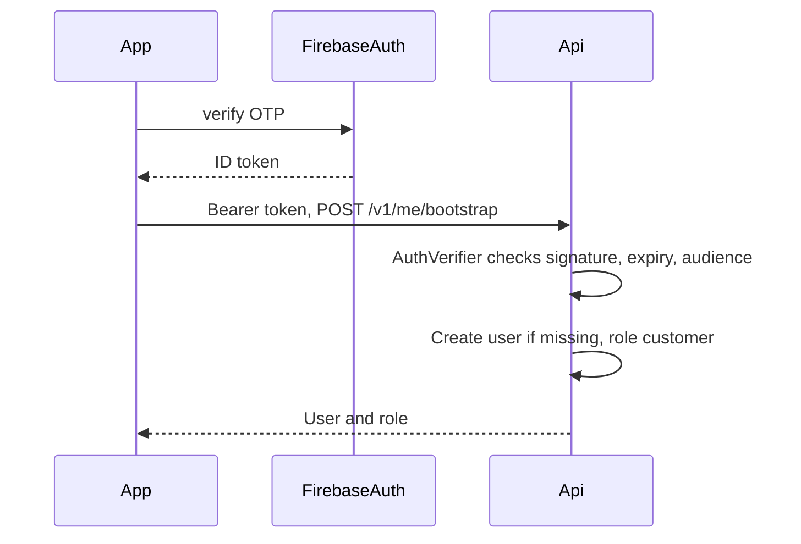

# 10 — Hybrid backend

## Responsibility split

| Concern | Flutter | Firebase client SDK | FastAPI |
| --- | --- | --- | --- |
| Sign-in UI, token refresh | Yes | Auth SDK | Verifies the ID token |
| Profile, vehicles, bookings, payments | Renders DTOs from the API | Read-only where noted | All writes |
| Booking status, prices, coupons, wallet, ratings, `verified` | Displays | **No writes** | Writes with Admin SDK |
| Live location | Publishes own node, subscribes to the booking | RTDB write of own node only | Reads for staleness sweeps. Does not own the high-frequency path |
| Mechanic presence heartbeat | Writes own presence node | RTDB | Sweeper marks offline in Firestore when heartbeat dies |
| Chat messages | Subscribes | Read. Send goes to the API so we can validate and rate-limit | Writes the message document |
| Parts photos | Compresses, uploads bytes to a signed URL | Storage upload with the signed URL | Creates the proof record, checks the three kinds exist |
| Push | Receives and displays | FCM client | Sends |
| Maps polyline | Draws | No | Calls Google if the client should not hold a server key. The client may call the Maps SDK for the map tiles only |
| Timers | Shows a countdown that can be wrong | No | Cloud Tasks hits FastAPI |

### The location exception

Clients may write only:

- `liveLocations/{bookingId}/mechanic` if the auth uid equals the assigned mechanic and the booking is in `mechanicAssigned`, `enRoute`, or `arrived` (the rules read the booking status from Firestore via a stored `activeBooking` claim or, simpler for MVP, from a mirrored `bookingGates/{bookingId}` document that the API maintains with `mechanicId`, `customerId`, and `locationOpen: bool`).
- `liveLocations/{bookingId}/customer` for the customer, same gate.
- `presence/{uid}` for the signed-in mechanic, and only that path.

They may not write the other party's node, a booking document, or a payment. Rules in the appendix show this. If the gate document and the booking ever disagree, the API is the authority and the next status write fixes the gate.

Chat is not a client write. It is easy to get wrong (abuse, phone numbers, media). The API writes it. The client listens. That is still "read realtime."

Notification `readAt` is a client write on the user's own notification docs. It cannot change `title` or `deepLink`. Rules allow update of `readAt` only.

## Security rules, by collection

Full samples live in [chapter 25](25-glossary-and-appendices.md). The behavior:

| Path | Client read | Client write |
| --- | --- | --- |
| `users/{uid}` | Self. Admin via API, not via client rules | None |
| `users/{uid}/vehicles` | Self | None |
| `bookings/{id}` | Customer or assigned mechanic | None |
| `bookings/{id}/messages` | Parties | None |
| `payments`, `ledger`, `coupons`, `reviews`, `invoices`, `auditLog`, `serviceCatalog` | No direct client read of payments, ledger, coupons, audit. Reviews: public read of `published` only. Catalog: any signed-in read | None |
| `mechanics/{id}` public fields | Any signed-in user | None. The public profile is what the API is willing to put in the document. Documents subcollection: owner read, no client write |
| `notifications` | Owner | Update `readAt` only |
| RTDB `liveLocations` | Parties while `locationOpen` | Own role only |
| Storage | Signed URLs only. Default rules deny | Deny except matching signed URL |

Admin users do not get a blanket client read. They use the API, which uses the Admin SDK and bypasses rules. That keeps rules small.

## FastAPI shape

- Python 3.12, Pydantic v2, `pydantic-settings`.
- Uvicorn on Cloud Run, port 8080, `$PORT`.
- Router prefix `/v1`. Health at `/health` with no auth.
- Middleware: request id, access log, CORS allow-list (app origins and admin web), rate limit, error mapper.
- Auth dependency: `Authorization: Bearer <Firebase ID token>` on every route except `/health`, `/v1/payments/cashfree/webhook`, and `/v1/internal/jobs/*`.
- Internal job routes check an OIDC token from Cloud Tasks or Scheduler, audience = the service URL. They are not public.
- Webhook route checks the Cashfree signature and nothing else. No bearer token.

Dockerfile (written in M00): slim Python image, non-root user, `pyproject` install, no keys baked in.

## Endpoint inventory

All JSON. Schemas in [chapter 12](12-api-contracts.md).

| Method | Path | Actor | Idempotent |
| --- | --- | --- | --- |
| GET | `/health` | public | yes |
| POST | `/v1/me/bootstrap` | signed in | yes |
| GET | `/v1/me` | self | yes |
| PATCH | `/v1/me` | self | yes |
| POST | `/v1/me/devices` | self | yes, by token |
| GET/POST | `/v1/vehicles` | customer | POST uses key |
| PATCH/DELETE | `/v1/vehicles/{id}` | owner | yes |
| GET/POST | `/v1/addresses` | customer | POST uses key |
| GET | `/v1/catalog/services` | signed in | yes |
| POST | `/v1/quotes` | customer | yes |
| POST | `/v1/bookings` | customer | key required |
| GET | `/v1/bookings/{id}` | party or staff | yes |
| GET | `/v1/bookings` | scoped to actor | yes |
| POST | `/v1/bookings/{id}/cancel` | customer or staff | key |
| POST | `/v1/bookings/{id}/transitions` | mechanic or staff | key |
| POST | `/v1/bookings/{id}/lines` | mechanic | key |
| POST | `/v1/bookings/{id}/lines/{lineId}/decision` | customer | yes |
| POST | `/v1/bookings/{id}/tracking-links` | customer | yes |
| GET | `/v1/public/tracking/{token}` | public token | yes |
| POST | `/v1/offers/{id}/accept` | mechanic | yes |
| POST | `/v1/offers/{id}/reject` | mechanic | yes |
| POST | `/v1/mechanic/application` | mechanic | yes |
| POST | `/v1/mechanic/availability` | mechanic | yes |
| POST | `/v1/mechanic/heartbeat` | mechanic | yes |
| GET | `/v1/mechanic/earnings` | mechanic | yes |
| POST | `/v1/uploads/sign` | signed in | yes |
| POST | `/v1/payments` | customer | key |
| POST | `/v1/payments/cashfree/webhook` | Cashfree | by event id |
| POST | `/v1/payments/{id}/cash-collected` | mechanic | yes |
| POST | `/v1/payments/{id}/cash-confirm` | customer | yes |
| POST | `/v1/wallet/topups` | customer | key |
| GET | `/v1/wallet` | customer | yes |
| POST | `/v1/coupons/validate` | customer | yes |
| GET | `/v1/invoices/{bookingId}` | customer or staff | yes |
| POST | `/v1/bookings/{id}/messages` | party | key |
| POST | `/v1/reviews` | customer | one per booking |
| GET | `/v1/mechanics/{id}/reviews` | signed in | yes |
| POST | `/v1/admin/mechanics/{id}/verification` | admin | yes |
| POST | `/v1/admin/users/{id}/suspension` | admin | yes |
| POST | `/v1/admin/refunds` | admin | key |
| CRUD | `/v1/admin/coupons` | admin | yes |
| GET | `/v1/admin/disputes` | staff | yes |
| POST | `/v1/admin/disputes/{id}/resolve` | admin | yes |
| GET | `/v1/admin/revenue` | staff | yes |
| GET | `/v1/admin/audit` | admin | yes |
| POST | `/v1/internal/jobs/dispatch-timeout` | OIDC | yes |
| POST | `/v1/internal/jobs/reconcile-payments` | OIDC | yes |
| POST | `/v1/internal/jobs/stale-presence` | OIDC | yes |
| POST | `/v1/internal/jobs/location-retention` | OIDC | yes |

M00 ships `/health` only. Later milestones add their routes. The old `POST /login` is deleted in M00 because it issues fake tokens and teaches the wrong pattern. Nothing on the live router calls it.

## Background work

| Job | Trigger | What it does |
| --- | --- | --- |
| Offer timeout | Cloud Task 45s (SOS 20s) after offer create | If still open, expire and offer the next mechanic or fail |
| Extra-work timeout | Cloud Task 10 min | Reject the pending line |
| Cash confirm timeout | Cloud Task 2 hours | Notify support. Does not auto-pay |
| Payment reconcile | Scheduler every 15 min | Fetch pending gateway orders |
| Presence sweep | Scheduler every 1 min | Mechanics with heartbeat older than 2 min go offline |
| Location retention | Scheduler nightly 03:00 IST | Delete old RTDB nodes |
| Wallet invariant | Scheduler nightly | Compare ledger sum to stored balance, log error if not equal |
| Invoice render | Cloud Task immediately after `paid` | Build PDF, store, notify |

Cloud Tasks target `POST /v1/internal/jobs/...` with OIDC. The handler is idempotent: doing it twice is a no-op once the offer is no longer open. Scheduler uses the same kind of endpoint. We do not subscribe the API to Pub/Sub for these. We do not deploy Cloud Functions.

## Auth flow

Custom claims (`role`, `mechanicVerified`) are set by the Admin SDK when verification or an invite changes. The client refreshes the token after those events. The API still loads the user record for suspension checks. Claims are a cache for rules and routing, not the only check.

## Cloud Run

| Env | Min instances | Max | Notes |
| --- | --- | --- | --- |
| dev | 0 | 2 | Emulators, fake vendors |
| staging | 0 | 5 | Real Firebase project, Cashfree sandbox |
| prod | 1 | 20 | Min 1 so webhooks are not cold |

Concurrency 40 per instance to start. CPU always allocated on prod min instance. Request timeout 60 seconds. Invoice rendering is a task, not a long request.

Region: `asia-south1` (Mumbai), same region as Firebase when the project is created. This is a default. The owner confirms the project.

## Cost and quota risks

| Risk | Why | Mitigation |
| --- | --- | --- |
| RTDB writes | 5 second GPS | Duty cycle, stop after arrival, one node overwritten not appended |
| Firestore reads from listeners | Chat and booking listeners | One listener per active booking, not per list row |
| Maps calls | ETA every few seconds | At most one route call per 30 seconds per booking |
| Cloud Run min instance | Always-on cost | Only prod, only one |
| FCM | Low | Fine at MVP volume |
| Storage | Photos | Compression limits, no video |
| Cashfree | Fees | Not an engineering quota. Record it in finance ops |

Log a metric `maps_route_calls` and `rtdb_location_writes` so a bug that tight-loops is visible within a day.

## Lock-in

| Locked-in piece | Mitigation already in the design |
| --- | --- |
| Firestore queries and geohash | Repositories are ports. Postgres mapping is written |
| Firebase Auth tokens | `AuthVerifier` port |
| RTDB | `LocationTrackingService` port |
| FCM | `NotificationSender` port |
| GCP Cloud Tasks | `JobScheduler` port. Payloads are plain HTTP |
| Cashfree | `PaymentGateway` port. Domain stores our payment id |
| Google Maps | `MapsService` port. Polylines are just strings |

What remains sticky even with ports: IAM, the Cloud Run deploy, and Security Rules. That is acceptable. We are not pretending we can move clouds in a weekend. We are pretending we can change Cashfree or Auth without touching a widget, because that is the decision the team has not finished making.
