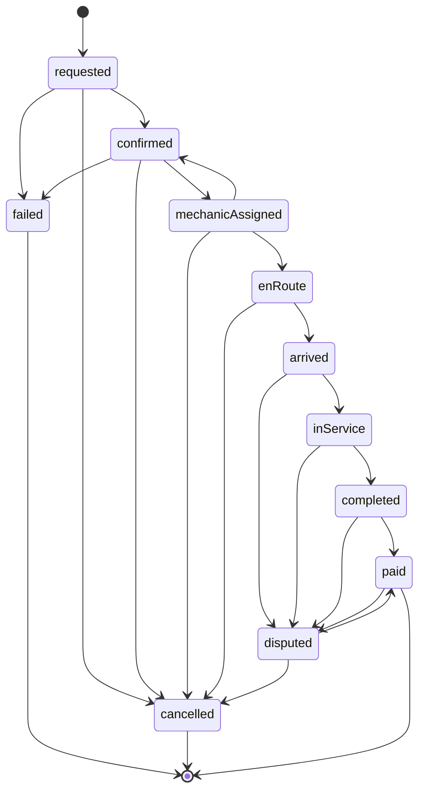
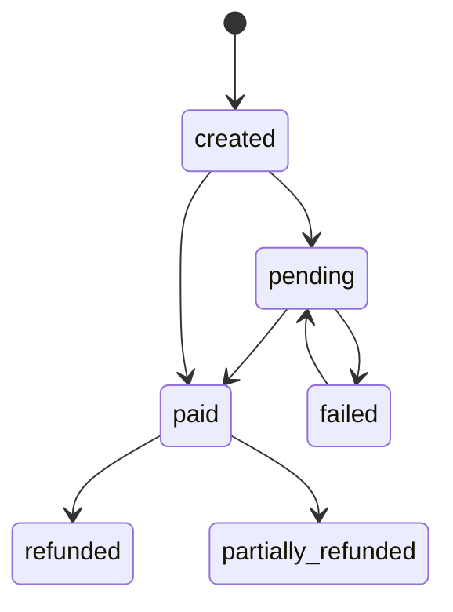
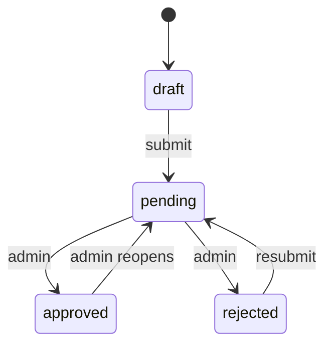

# 13 — State machines

Transitions not listed are illegal. The server checks the actor and the current status. The UI should only offer the next legal action, and the server still checks.

## Booking

`mechanicAssigned --> confirmed` is the reassignment path: the previous mechanic is cleared, status returns to `confirmed`, and dispatch offers the next person. The customer-facing copy still says "Finding a mechanic" whenever status is `confirmed` after creation.

| From | To | Actor | Notes |
| --- | --- | --- | --- |
| `requested` | `confirmed` | system | Validation and quote succeeded in the same request. Callers usually see `confirmed` immediately |
| `requested` | `failed` | system | Outside service area or outside hours for non-SOS |
| `requested` or `confirmed` or `mechanicAssigned` | `cancelled` | customer, support, admin | Fee ₹0 |
| `confirmed` | `mechanicAssigned` | system | After accept |
| `mechanicAssigned` | `enRoute` | assigned mechanic | |
| `mechanicAssigned` | `confirmed` | system | Reject, timeout, or heartbeat lost before en route |
| `enRoute` | `arrived` | assigned mechanic | |
| `enRoute` | `cancelled` | customer, support, admin | Cancel fee applies |
| `arrived` | `inService` | assigned mechanic | |
| `inService` | `completed` | assigned mechanic | All required parts photos stored. Pending extra lines must be approved or rejected |
| `completed` | `paid` | system | Payment use case |
| `arrived`, `inService`, `completed`, `paid` | `disputed` | customer or support | |
| `disputed` | `paid` | admin | Resolved without cancelling, including a partial refund |
| `disputed` | `cancelled` | admin | Full reversal |

Terminal states: `failed`, `cancelled`, `paid`. A dispute can reopen `paid`. A second dispute on the same booking returns `409`.

Customer-visible labels:

| Status | Label |
| --- | --- |
| `requested` | "Sending your request" |
| `confirmed` | "Finding a mechanic" |
| `mechanicAssigned` | "Mechanic assigned" |
| `enRoute` | "Mechanic is on the way" |
| `arrived` | "Mechanic arrived" |
| `inService` | "Service in progress" |
| `completed` | "Waiting for payment" |
| `paid` | "Paid" |
| `cancelled` | "Cancelled" |
| `failed` | "No mechanic available" |
| `disputed` | "In review" |

## Payment

| From | To | Actor | Notes |
| --- | --- | --- | --- |
| `created` | `pending` | system | Gateway order created, or cash waiting |
| `created` | `paid` | system | Wallet debit that succeeded immediately |
| `pending` | `paid` | system | Verified webhook, reconciler, or both cash marks |
| `pending` | `failed` | system | Gateway failure or customer abandoned after 30 minutes |
| `failed` | `pending` | customer | They retry. New gateway order, same payment row, version bump |
| `paid` | `refunded` | admin | Full amount |
| `paid` | `partially_refunded` | admin | Partial, once |

Cash substeps live on the payment as `cashMechanicMarkedAt` and `cashCustomerMarkedAt`. Status stays `pending` until both are set, or until staff confirms.

## Mechanic availability

Not a booking status. Fields on the mechanic:

| `verificationStatus` | `online` allowed? |
| --- | --- |
| `draft` or `pending` or `rejected` | No |
| `approved` | Yes, if heartbeat is fresh |

Heartbeat older than 2 minutes forces `online=false` even if the last toggle was on. A new heartbeat does not turn them on. They toggle again. This avoids a dead phone collecting offers.

## Verification

`verified` boolean is true only in `approved`. Reopen sets `verified=false` and forces `online=false`.

## Offer

`open` → `accepted` | `rejected` | `expired`.

One open offer per booking. Accepting sets the booking to `mechanicAssigned` and expires any other open offer (there should not be one). The unique constraint is "one open offer per booking" in the use case, enforced with a transaction.

## Review

`pending` → `published` | `hidden`. Empty text skips `pending` and is `published`. `published` → `hidden` by staff. No delete.

## Dispute

`open` → `resolved` | `rejected`. Notes do not change status.
