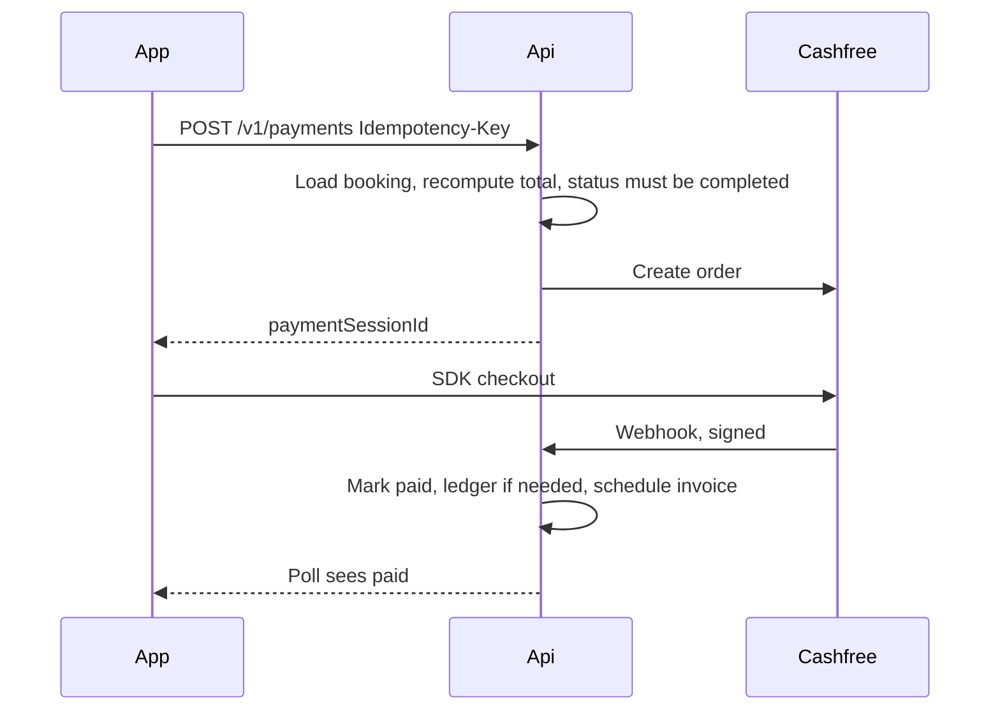

# 15 — Payments

## Principles

- The phone is not a source of truth for "paid."
- We never see, log, or store a card number, CVV, or UPI PIN. Cashfree's SDK and page do.
- Amounts are computed on the server in paise.
- Every capture and refund is idempotent.
- A webhook with a bad signature changes nothing.

## Methods

| Method | Gateway | When money moves |
| --- | --- | --- |
| `upi`, `card`, `netbanking` | Cashfree | After `completed`, customer pays the approved total |
| `wallet` | Internal ledger | After `completed`, if balance is enough. Top-up earlier via Cashfree |
| `cash` | None | Mechanic marks collected, customer confirms |

Card and netbanking are `payment_method` hints to Cashfree. Our enum stores them so the invoice can name the method. The domain status machine is the same.

There is no charge at booking time in MVP, other than a coupon reservation. The convenience fee is part of the final total, not a separate immediate charge. This avoids refunds when nobody accepts the job. **Assumption:** if the team later wants a cancellation fee collected from a card before `enRoute`, that is a second payment record of type `cancel_fee`, still through the same port.

Cancel fee on an online job that is not yet paid: create a small Cashfree order for the fee. If the customer does not pay it within 24 hours, record a negative ledger entry (debt) and block the next booking with `402` until they clear it or support waives it. Cash cancel fee uses the same debt.

## Online flow

1. Recompute the quote from approved lines. If it differs from `approvedTotalPaise`, stop and return `409` `total_changed` so the client refreshes. Do not charge the stale amount.
2. Create our payment row `pending` and the Cashfree order for that exact paise amount. Store `gatewayOrderId`.
3. Return `paymentSessionId` to the app. The app opens the Cashfree SDK.
4. The app returning "success" only moves the UI to "Waiting for confirmation." It does not call a "mark paid" endpoint.
5. Webhook handler:
   - Read the raw body.
   - `PaymentGateway.verifyWebhook`. On failure, `401` and no write.
   - If `eventId` was already applied, return `200`.
   - If the amount or order id does not match our row, leave the row `pending`, write an audit event `payment_mismatch`, alert, return `200` so the provider does not retry forever. Staff reconciles.
   - If status is success, transition `pending` → `paid`, set booking `completed` → `paid`, schedule the invoice task, send notifications.
   - If status is failed, transition `pending` → `failed`.

## Webhook delayed or lost

The app polls `GET /v1/payments/{id}` every 3 seconds for 2 minutes, then shows "Payment is still processing. We'll notify you." The booking stays `completed`.

Every 15 minutes the reconciler loads `pending` payments older than 5 minutes and calls `PaymentGateway.fetch`. The fetch result goes through the same apply function as the webhook. Two appliers cannot double-apply because both check `version` and the stored event id.

## Cash

1. Payment row created at `completed` with method `cash`, status `pending`, no gateway.
2. Mechanic taps collected. Set `cashMechanicMarkedAt`. Notify the customer: "Confirm you paid ₹X in cash."
3. Customer confirms. Set `cashCustomerMarkedAt`. If both timestamps exist, status `paid` and booking `paid`.
4. Customer denies. Booking `disputed`. Payment stays `pending`.
5. After 2 hours with only the mechanic mark, notify support. Do not auto-confirm.

## Wallet

Top-up: same Cashfree flow, payment row with `bookingId` null and reason `topup`. On `paid`, append a credit ledger entry and increment the stored balance in one transaction.

Booking pay: `WalletService.debit` and payment `paid` in one transaction. If the process crashes between them, the nightly invariant job and the unique `bookingId` on the debit entry repair or alert. The debit entry id is deterministic: `wallet_{paymentId}`.

## Refunds

`POST /v1/admin/refunds` with payment id, amount, idempotency key, dispute id optional.

- Online: `PaymentGateway.refund`. On gateway success, mark `refunded` or `partially_refunded`, append a ledger credit if the original method was wallet, notify the customer.
- Wallet original: credit the wallet. No Cashfree call.
- Cash: credit the wallet. The screen tells the customer the refund is in the wallet because cash cannot be pushed back.
- Amount cannot exceed the captured amount minus previous refunds.

## Coupons

`validate` at quote time does not consume the coupon.

`redeem` inside the payment transaction, unique on booking id. If the coupon became invalid, the payment is refused with `coupon_rejected` and the client must quote again. The coupon is not silently dropped.

## Reconciliation report

Admin revenue reads payments in `paid` and refunds, grouped by method and day in IST. Bookings in `completed` with no payment older than 30 minutes appear as "unpaid" on the admin order list. They are not revenue.

## PCI boundary

| System | Card data |
| --- | --- |
| Flutter app | No fields for PAN or CVV. The SDK's own views handle them |
| FastAPI | Order id, amount, status, signature headers |
| Firestore | Same as FastAPI. No PAN |
| Logs | Gateway order id is allowed. Raw webhook body is not logged. Log the event id and the verify result |
| Crash reports | Strip request bodies on payment routes |

A reviewer who finds a card field in our UI or schema rejects the PR.

## Sandbox

Dev and CI use `FakePaymentGateway`: `createOrder` returns a fake session, a test helper posts a signed-looking event through the same verify function using a test secret, and refunds succeed. Staging uses Cashfree's sandbox keys from the secret store. Production keys are a different secret. The adapter refuses to start if `APP_ENV=prod` and the key prefix is a sandbox prefix.
